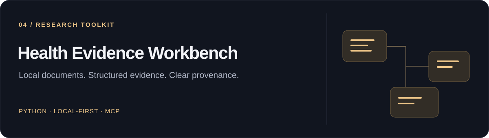

# Health Evidence Workbench

Помощник для работы с письменными медицинскими документами и научными
источниками в Codex. Он предназначен для вопросов по результатам анализов,
обследований и заключений разных видов: читает предоставленные документы,
помогает найти сохранённые материалы и объясняет их с опорой на проверенные
источники. Перечень медицинских специальностей и типов обследований не задан
заранее.

Проект исследовательский: модель может ошибаться в чтении документа,
интерпретации и ссылках. Результат не является подтверждённым диагнозом,
назначением лечения или заменой клинической оценки.

## Как это работает

1. Вы предоставляете документ или задаёте вопрос по доступному архиву.
2. Для нового документа Codex явно выбирает профиль и проверяет, сохранён ли
   идентичный файл. При неясной принадлежности он уточняет её у пользователя.
3. По умолчанию оригинал сохраняется в выбранном архиве, если идентичный файл
   не найден; модель читает доступные страницы и сохраняет текстовую
   расшифровку. При повторном обращении можно использовать ранее сохранённые
   документы. Если проверка архива неполная, нельзя утверждать, что дубликата
   нет; пределы проверки нужно показать и действовать с учётом неопределённости.
4. Для медицинских выводов Codex выделяет существенные данные и пробелы, ищет
   актуальные клинические рекомендации и исследования и сопоставляет их с
   контекстом вопроса.

При вопросах о действиях и лечении ответ должен различать то, что рекомендуют
актуальные клинические руководства; релевантные перспективные варианты хотя бы
с первичными данными, включая добавки, процедуры и практики; и подходы, польза
для которых исследования показали отсутствие эффекта или которые обоснованно
не рекомендуются либо считаются рискованными в определённых условиях.
Недостаток данных сам по себе не доказывает неэффективность или вред. Перспективные
варианты следует обсуждать по умолчанию, отдельно от рекомендаций и с указанием
ограничений. Статус рекомендации и надёжность доказательств — разные вещи.
Ответ должен приводить источники, условия применимости и значимые неизвестные.

Для изображений и сканов страницы читает модель в диалоге; отдельный локальный
OCR отключён. Доступность вложения, возможность просмотра формата и качество
распознавания зависят от среды. Если страницу или файл не удалось прочитать,
это нужно сообщить; текстовая расшифровка сама по себе не подтверждает
правильность или полноту прочитанного. По письменному заключению нельзя делать
вид, что модель просмотрела сами медицинские снимки.

### Люди и архив

Профили и пути к их папкам задаются пользователем локально: имена не зашиты в
проект, конфигурация поддерживает от 1 до 100 профилей. Например, отдельные папки могут называться
`profile-a` и `profile-b`; это условные примеры, а не обязательные имена.
Перед записью и поиском нужно явно выбрать человека. Если принадлежность
документа неясна, её нужно уточнить. Не предполагается, что человек определяется
по одному только названию файла.

Храните настройки и медицинские документы **за пределами публичного клона**.
Оригинал и подготовленный моделью текст сохраняются рядом; существующие файлы
не следует молча заменять. Старые архивы могут использовать другие имена и
форматы. Наличие текстового файла рядом не доказывает его соответствия
оригиналу; поиск только по текстам не гарантирует полного охвата архива.
Для нового документа Codex ориентируется на структуру выбранного профиля и
содержание отчёта, выбирает подходящую папку и может создать недостающую.
Старые документы автоматически не перемещаются. Решение о категории принимает
модель, поэтому его точность не гарантирована. При неясной категории она
использует общий раздел и сообщает об этом.
Раздельное структурированное хранилище v2 — дополнительная возможность, не
обязательная для простого файлового сценария; данные в него автоматически не
мигрируются.

Для файлового поиска и сохранения создайте локальный JSON-файл конфигурации
**вне клона** и укажите существующие отдельные папки. Например, значения ниже —
только шаблон, а не пути, которые нужно использовать буквально:

```json
{
  "profiles": [
    {"id": "person_1", "label": "Первый профиль", "root": "/absolute/private/person-1"},
    {"id": "person_2", "label": "Второй профиль", "root": "/absolute/private/person-2"}
  ]
}
```

Количество и отображаемые названия профилей можно изменить. ID — короткий
идентификатор латинскими буквами, цифрами, `_` или `-`; названия могут быть на
любом языке. Папки должны существовать и не пересекаться. Укажите Codex путь к
этому конфигу и профиль. При подготовке плагина путь к конфигу можно передать
через `--profiles-config`: он сохранится только в локальном указателе плагина,
а содержимое конфига и документов не будет скопировано в плагин. Если путь не
настроен, при обращении к архиву Codex должен его уточнить. Приватные пути,
названия и содержимое файлов не должны
попадать в публичные запросы или коммиты. Новые оригиналы и тексты публикуются
без перезаписи. При проверке дубликатов одинаковые размер и SHA-256 обозначают
совпадение байтов, но не устанавливают личность человека или происхождение TXT.
Неполный обход не доказывает отсутствия копии. Поиск по архиву сейчас охватывает
только доступные UTF-8 `.txt` и сообщает фактические ограничения.
Для нового файлового сценария исходник ограничен 64 МиБ, переданная текстовая
расшифровка — 8 МиБ; поиск дубликатов также ограничен по времени и объёму.
При превышении ограничений или недоступности файлов обработка сообщает об этом,
а не подтверждает полноту поиска.

Используйте реальные пути без символических ссылок: например, на macOS путь
`/tmp` может быть ссылкой, а его физический вариант — `/private/tmp`. Нельзя
обходить отказ в доступе изменением настроек безопасности. При аварийном
прерывании записи может остаться временная ссылка; инструмент предложит её
проверить, но не удаляет её самостоятельно. Аргументы команд и их результаты
могут содержать частные пути и названия профилей; не публикуйте их. Не меняйте
структуру архива одновременно с обработкой: проверки не защищают полностью
от конкурентной подмены каталогов другим процессом с теми же правами; при сбое
могут остаться частично созданные папки.

## Установка и проверка

Для подготовки нужны Python 3.11+, [uv](https://docs.astral.sh/uv/) и Codex.
В терминале из корня клона установите зависимости и проверьте локальные
файловые операции на вымышленных данных:

```bash
uv sync --locked --extra dev --extra mcp --extra documents
.venv/bin/python -I -B scripts/check-simple-setup --json
```

Чтобы подготовить отдельный неактивный комплект плагина, выберите новый,
ещё не существующий каталог **вне клона**. Например, из корня клона:

```bash
.venv/bin/python -I -B scripts/prepare-v2-install \
  --python "$PWD/.venv/bin/python" \
  --profiles-config /absolute/private/profiles.json \
  --output "$PWD/../health-workbench-setup" --isolation host
```

Замените путь после `--profiles-config` на абсолютный путь к своему приватному
JSON-файлу, созданному ранее. Этот параметр можно опустить, но тогда при работе
с архивом путь потребуется указать отдельно. Указатель не выбирает пациента:
профиль по-прежнему определяется по запросу и не угадывается при сомнениях.

Команда создаёт отдельную конфигурацию публичного поиска и копию плагина,
проверяет запуск его MCP и печатает команды регистрации в Codex. Сама она
плагин не устанавливает и текущие настройки Codex не меняет. При заданном
конфиге она проверяет его и доступность каталогов, но не читает меддокументы.
Если режим доступа конфига или корня профиля даёт какие-либо права группе
или другим пользователям, отчёт содержит предупреждение, но автоматически права не
меняет. Права родительских папок и ACL этой проверкой не устанавливаются.
Если каталог уже существует, команда откажется его перезаписать. Выбирайте
доверенный родительский каталог: защита от его конкурентной подмены не заявлена.
`host` — режим разработки с логическим разделением, без ограничения доступа
процесса к сети и файлам средствами ОС. Режим `macos_enforced` допустим только
после успешной проверки в вашей среде; автоматического перехода на `host` нет.

После подготовки выполните напечатанные команды, проверьте `/hooks`, доверьте
соответствующий защитный hook и проверьте его отказ на синтетическом примере;
затем откройте новый чат. Для проверки можно попросить Codex вызвать публичный
`plan_search` с вымышленным полем `patient_id: synthetic-test` внутри `request`
и подтвердить, что вызов блокирует именно hook до отправки серверу. Отказ самой
схемы сервера не подтверждает работу hook. В новом чате также попросите проверить,
что в корне установленного плагина доступен `.local-install.json`, а указанные
в нём локальные команды существуют; не публикуйте содержимое этого файла.
Если hook или локатор не видны, настройка не завершена.

Реальная установка в Codex, доверие hook,
доступность PubMed и поведение нового чата **ещё не проверены** этим проектным
тестом. Комплект зависит от расположения клона и Python: после переноса его
нужно подготовить заново. Подготовитель использует новое имя marketplace и не
удаляет прежние установки: после проверки новой версии отдельно проверьте,
какие версии активны, чтобы избежать неоднозначного выбора скилла. Подробнее:
[настройка runtime](docs/v2/runtime.md).

### Проверка локальных файловых операций

Для повторной проверки нужен Python 3.11 или новее и поддержка необходимых
POSIX-операций файловой системы. Из корня клона выполните:

```bash
python3 -I -B scripts/check-simple-setup --json
```

Проверка создаёт временные вымышленные данные и проверяет копирование файла,
сохранение переданного текста, поиск в выбранном профиле, дубликат, повтор и
конфликт без перезаписи. Она не
использует личный архив и не выполняет поиск в сети. `"status": "passed"`
относится только к этим файловым операциям; при ошибке вывод содержит
`"status": "failed"` и причину.

Эта команда **не устанавливает и не активирует плагин**. Она также не
проверяет передачу вложений, визуальное чтение, правильность расшифровки,
идентификацию человека, полноту поиска в архиве, PubMed, приватность всей
системы или медицинскую корректность ответа.

Для работы в Codex v2-плагин требует отдельной настройки и проверки
подключения. Шаблон плагина включает три скилла и публичный исследовательский
MCP; приватный runtime настраивается отдельно и для простого чтения файлов не
является обязательным. Описание настройки и её ограничений находится в
[документации runtime v2](docs/v2/runtime.md). Прохождение локальной файловой
проверки не подтверждает, что установку плагина удалось завершить.

Для разработчиков полный набор тестов запускается в подготовленном окружении
с зависимостями разработки командой `uv run pytest`. Результат зависит от
доступных инструментов, прав и среды; например, ограничения вложенной
песочницы macOS могут препятствовать части проверок. Тесты кода не заменяют
проверку медицинской применимости на подходящих примерах.

## Приватность и сохранность

- Исключайте документы, тексты, конфигурации профилей, ключи и рабочие базы из
  Git. Перед публикацией проверяйте состав коммита: `.gitignore` не заменяет
  проверки и не удаляет данные из предыдущих коммитов.
- Ограничивайте права доступа к архиву и храните отдельную резервную копию;
  проверяйте, что восстановление копии действительно возможно.
- Для публичного поиска формулируйте минимальный обезличенный вопрос. Не
  отправляйте в поисковые сервисы исходные документы, имена или личные пути.
  Автоматические фильтры являются дополнительной защитой, а не гарантией
  обезличивания.
- Локальное хранение файлов не означает, что модель работает полностью
  офлайн: выбранные страницы обрабатываются в диалоге Codex. Разделение ролей
  внутри общей беседы не является строгой изоляцией данных.
- Проверка хэша и HMAC помогает выявить отдельные изменения данных, но не
  шифрует их и не подтверждает медицинскую правильность.

## Прежний runtime: проверка манифеста

Ниже — технические команды для прежнего публичного MCP на macOS, **не быстрая
установка v2**. При проверенных изменениях runtime его манифест и закреплённый
хэш необходимо обновить согласованно. Следующий блок также используется
скриптом обновления манифеста:

```bash
scripts/update-runtime-manifest
scripts/run-public-mcp --expected-runtime-manifest-sha256 \
  67a9a1613fa6bc28d72bbbd096437d4838eda15c4387987a150a16dec85d8915
```

Не запускайте эти команды как замену настройке v2. В зависимости от окружения
прежний runtime может требовать дополнительных зависимостей и разрешений.

## Документация

- [Локальная работа с PDF](docs/local-pdf-workflow.md)
- [Документы и сохранённый текст v2](docs/v2/document-intake.md)
- [Научный поиск и проверка источников](docs/v2/research.md)
- [Архитектура и ограничения v2](docs/v2/README.md)
- [Настройка runtime v2](docs/v2/runtime.md)
- [Правила безопасности](SECURITY.md) и [участие в разработке](CONTRIBUTING.md)

[Лицензия MIT](LICENSE).
